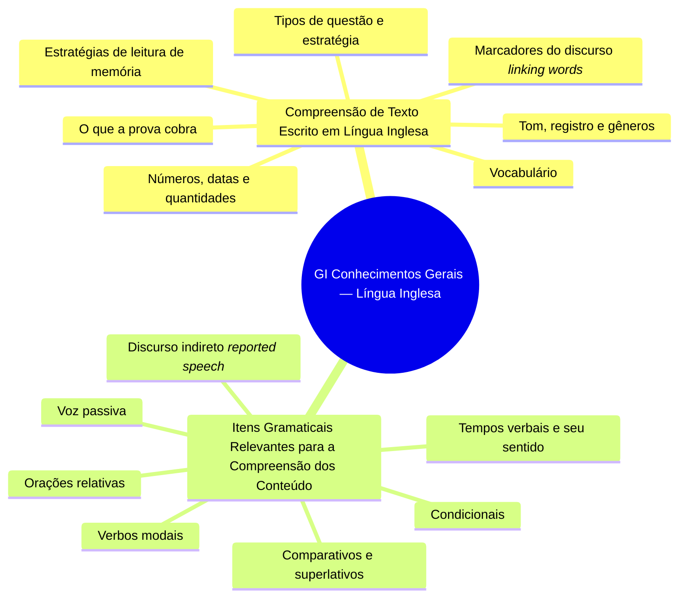

# Mapa mental — Módulo GI: Conhecimentos Gerais — Língua Inglesa

Estrutura (arquivos e seções) gerada a partir de `conteudo-gerais/02-lingua-inglesa/`. Organiza o conteúdo; não mapeia relações conceituais.

