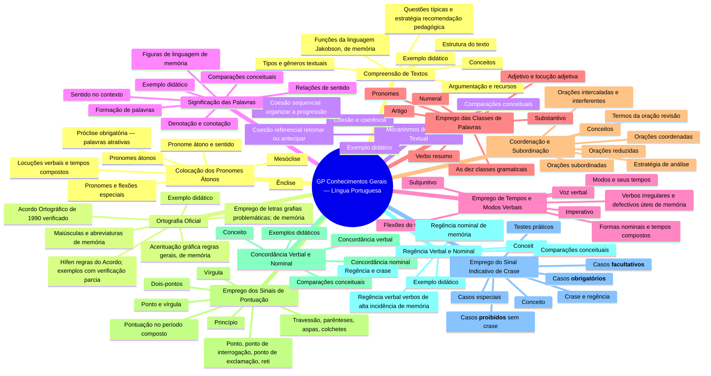

# Mapa mental — Módulo GP: Conhecimentos Gerais — Língua Portuguesa

Estrutura (arquivos e seções) gerada a partir de `conteudo-gerais/01-lingua-portuguesa/`. Organiza o conteúdo; não mapeia relações conceituais.

