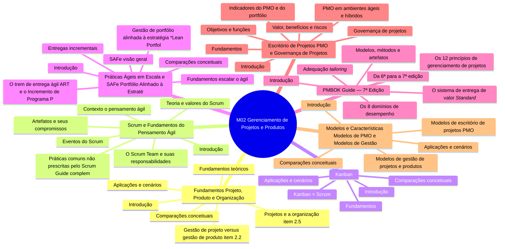

# Mapa mental — Módulo M02: Gerenciamento de Projetos e Produtos

Estrutura (arquivos e seções) gerada a partir de `conteudo/02-projetos-produtos/`. Organiza o conteúdo; não mapeia relações conceituais.

