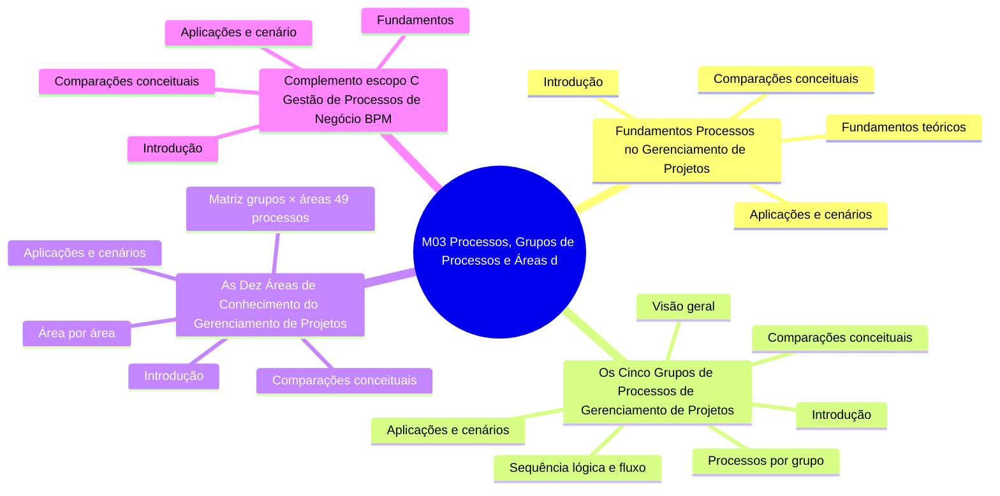

# Mapa mental — Módulo M03: Processos, Grupos de Processos e Áreas de Conhecimento

Estrutura (arquivos e seções) gerada a partir de `conteudo/03-processos-gerenciamento/`. Organiza o conteúdo; não mapeia relações conceituais.

